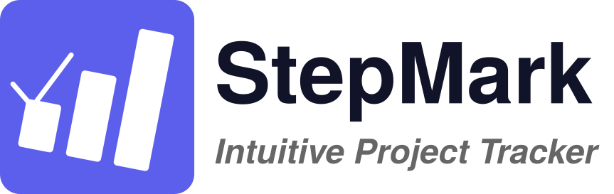

<p align="center">
  <a href="https://xtyangpsp.github.io/StepMark/">
    
  </a>
</p>

<h2 align="center">
  🔗 <a href="https://xtyangpsp.github.io/StepMark/"><b>https://xtyangpsp.github.io/StepMark</b></a>
</h2>

<p align="center">
  A lightweight project progress tracker for research groups and graduate students,<br>
  built as a single self-contained HTML file — no install, no server, no account.
</p>

<p align="center">
  
  
  
</p>

<p align="center">
  📖 <a href="https://xtyangpsp.github.io/StepMark/manual.html"><b>Read the user manual</b></a> — every feature explained with pictures
</p>

## Features

- **Two-row layout per project** — key info on top, details below
- **Priority badges** — High / Medium / Low / Archived, picked from a drop-down
- **Categories** — group projects as **Research**, **Teaching** or **Service**, or add your own categories (saved with your data) and remove them again later
- **Stage tracking** — Planning → In Progress → Analyzing → Writing → Under Review → On Hold → Done
- **Deadline & next step** — what needs to happen and by when
- **Blocker categories** — flag what's blocking progress
- **Notes column** — free-form text per project
- **Filter** by priority and by category (the two combine)
- **Group by category** — collapsible sections with project counts
- **Sort** by priority, category, deadline, last updated, or name — across all projects or **within each category**
- **Manual ordering** — drag projects into your own order (or use the keyboard / ▲▼ buttons on phones); choosing a sort overrides it on screen and **Manual** brings it back
- **Phone-friendly** — the table turns into one card per project on narrow screens
- **Auto-saves to browser localStorage** — no account, no server
- **Export to Excel (.xlsx) or JSON** — for backups and sharing
- **Import from Excel or JSON** — restore or migrate data
- **Dark / light / system theme**
- **Export reminder banner** — appears when you have changes not yet backed up, and says how many projects changed and when you last exported
- **Built-in user manual** — linked from the toolbar, the footer and the About dialog

## Usage

<h3 align="center">
  🚀 Access StepMark online: <a href="https://xtyangpsp.github.io/StepMark/"><b>https://xtyangpsp.github.io/StepMark</b></a>
</h3>

Just open the link above in any modern browser — no install, no dependencies, no build step. Bookmark the URL for quick access. Your data lives in your browser's localStorage and is private to you.

Prefer to run it locally? Download `index.html` (and `manual.html` if you want the in-app manual link to work) into the same folder and open `index.html` in your browser.

### Quick start

1. Click **+ Add project**, type a name, and press `Enter`.
2. Choose a category, priority and stage; set the deadline and describe the next step.
3. Use **Export** to save a backup whenever the "Export to back up" reminder appears.

New to the app? The **[user manual](https://xtyangpsp.github.io/StepMark/manual.html)** walks through everything, including filtering, grouping, sorting and manual ordering.

### Organizing your projects

| Goal | How |
|------|-----|
| Show only some projects | **Priority** pills and the **Category** drop-down (they combine; choose *All* to clear) |
| Split the list into sections | **Group → By category**; click a section header to collapse it |
| Order by a field | **Sort by** Priority, Category, Deadline, Updated or Name; click again to reverse |
| Keep categories together when sorting | **Sort scope → Within categories** (automatic while grouped) |
| Use your own order | **Sort by → Manual**, then drag the ⠿ handle (or use `↑` / `↓` on a focused handle) |
| Add or remove a custom category | **+ New category…** in any Category list; **Manage** in the controls bar to remove one |

### Keyboard shortcuts

| Action | Key |
|--------|-----|
| Finish editing a cell | `Enter` |
| New line in Notes | `Shift + Enter` |
| Move between fields and buttons | `Tab` / `Shift + Tab` |
| Move a project up or down (handle focused, Sort by Manual) | `↑` / `↓` |
| Confirm a dialog (Add category, Save as) | `Enter` |
| Close a dialog | `Esc` |

## Data & privacy

All project data is stored in **your browser only** (`localStorage` key `pt-v2`). This includes your projects, their manual order, your custom categories, and your view settings (filter, group, sort, collapsed groups, theme). Nothing is sent to any server. StepMark asks your browser to treat this data as persistent so it is less likely to be cleared automatically when disk space is low (some browsers, such as Firefox, may ask your permission; this is a safeguard, not a guarantee). Data does not sync across browsers or devices — use **Export → Excel** or **Export → JSON** to back up and transfer your data.

Importing a file **replaces** the projects currently in the tracker, so export first if you want to keep them.

## Self-hosting

Because StepMark is a single HTML file, hosting it anywhere that serves static files works:

- **GitHub Pages** — URL: `https://xtyangpsp.github.io/StepMark`.
- **Any static host** — Netlify, Vercel, S3, etc. Drop `index.html` and `manual.html` in (keep them in the same folder, next to the `assets/` folder) and point a domain at it.
- **Local** — just open the file directly in a browser. Export/import still works.

Each user who opens the same hosted URL gets their own independent localStorage, so data never mixes between users.

## Export compatibility

**Excel** exports contain one sheet named `Projects` with these columns, and are compatible with Excel, Numbers, and LibreOffice Calc:

`Project` · `Description` · `Category` · `Priority` · `Lead` · `Stage` · `Stage Description` · `Deadline` · `Next Step` · `Blockers` · `Blockers Detail` · `Notes` · `Last Updated`

Rows are written in your current manual order. When importing, the first row must be a header row; unrecognized columns are ignored.

**JSON** exports follow this schema:

```json
{
  "exported": "ISO 8601 timestamp",
  "version": 2,
  "categories": ["custom category", "..."],
  "projects": [
    {
      "id": "unique id",
      "name": "", "desc": "",
      "category": "Research",
      "priority": "High | Medium | Low | Archived",
      "lead": "",
      "stage": "Planning | In Progress | Analyzing | Writing | Under Review | On Hold | Done",
      "stageDesc": "",
      "nextDate": "YYYY-MM-DD", "nextDesc": "",
      "blockersCategory": "None | Awaiting Feedback | Missing Data | Resources | Technical | External | Other",
      "blockersDetail": "",
      "notes": "",
      "updatedAt": 1700000000000
    }
  ]
}
```

`categories` lists the custom categories you have added (including ones no project uses yet); the built-in Research, Teaching and Service are always available. The order of the `projects` array is the manual order. Files exported by earlier versions (without `category` or `categories`) still import correctly.

Both formats can be re-imported into StepMark.

## Built with

- Vanilla HTML / CSS / JavaScript — no framework
- [SheetJS](https://sheetjs.com/) (XLSX) for Excel export/import
- [Plus Jakarta Sans](https://fonts.google.com/specimen/Plus+Jakarta+Sans) & [JetBrains Mono](https://fonts.google.com/specimen/JetBrains+Mono) via Google Fonts
- [Claude by Anthropic](https://claude.ai)

## Author

**Xiaotao Yang** · Purdue University, CSaT

## License

[AGPL-3.0](https://www.gnu.org/licenses/agpl-3.0.html) — free to use, modify, and distribute. If you modify StepMark and run it as a network service (e.g. host a modified version for others to use), you must also make your modified source available under the same license.
